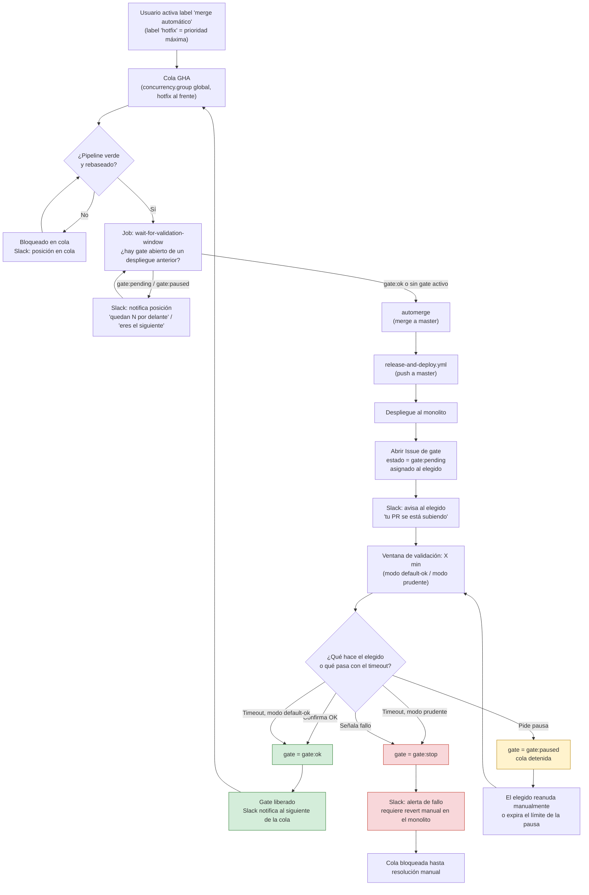

# Flujo de gestión de subidas al monolito

Sistema para serializar los merges automáticos al monolito, con una ventana
de validación tras cada despliegue que resuelve el "elegido" (el autor del
PR desplegado) de forma explícita o por timeout, y un bot de Slack que
elimina la dependencia de que un humano avise al siguiente de la cola.

El análisis automático de métricas por un LLM queda como mejora futura (ver
abajo) — hoy la validación es manual, el bot solo quita la carga de
comunicación, no la decisión.

## Componentes

- **Cola de merge (GHA `concurrency.group`)**: serializa los merges por orden
  de activación del label, reutilizando la cola nativa de GitHub Actions.
  Un label `hotfix` permite saltar al frente de la cola.
- **Gate de validación**: job intermedio que bloquea el siguiente merge de la
  cola hasta que la ventana de validación del despliegue anterior se resuelve.
- **Estado del gate**: un GitHub Issue por despliegue, con labels
  `gate:pending` / `gate:ok` / `gate:stop` / `gate:paused`, actualizado vía
  API. Sirve de almacén de estado y de log de auditoría.
- **Bot de Slack**: notifica proactivamente la posición en la cola ("eres el
  siguiente", "quedan 8 por delante", "tu PR se está desplegando"), abre la
  ventana de validación, y recoge la acción del elegido (OK / pausa / fallo).
- **El "elegido" (humano)**: sigue siendo quien decide si su despliegue va
  bien. El bot no sustituye su criterio, solo le avisa sin que tenga que
  estar pendiente de Slack y avisa al siguiente sin que él tenga que hacerlo.
- **Notificación de fallo**: si el gate pasa a `stop`, bloquea la cola y
  notifica que haría falta un revert manual en el monolito — no hay
  workflow de revert automático (en el monolito real no es un rollback
  trivial, así que no se simula).

## Modos de resolución de la ventana (configurable)

- **Modo "default OK"**: si el elegido no responde en X minutos, se asume que
  todo fue bien y el gate pasa a `gate:ok` automáticamente.
- **Modo "prudente"**: si no hay confirmación explícita, el gate se queda
  bloqueado (no pasa a `ok` por sí solo) hasta que el elegido confirme o
  expire un timeout más largo que requiere intervención manual.

El elegido puede, en cualquier momento de su ventana:
- Confirmar OK → libera la cola de inmediato.
- Pedir una pausa (duración fija o indefinida) → `gate:paused`, la cola se
  detiene hasta que él mismo la reanude.
- Señalar un fallo → `gate:stop`, bloquea la cola y notifica que haría
  falta un revert manual en el monolito.

## Diagrama de flujo

## Reparto de responsabilidades

| Elemento | Decide / hace | No puede |
|---|---|---|
| GHA merge action existente | Mergear si pipeline verde + rebaseado | Saltarse el orden de la cola (salvo `hotfix`) |
| Job `wait-for-validation-window` | Bloquear el siguiente merge mientras el gate esté `pending`/`paused` | Avanzar antes de `gate:ok` |
| Bot de Slack | Notificar posición en cola, recoger OK/pausa/fallo del elegido, aplicar timeout según el modo configurado | Decidir por el elegido, forzar un merge o un despliegue |
| El elegido (humano) | Confirmar OK, pausar, o señalar fallo de su propio despliegue | Saltarse la cola sin label `hotfix` |

## Futuro: análisis automático de métricas (LLM)

No forma parte del MVP. La idea original — que un LLM monitorice métricas
(Kibana/Datadog) durante la ventana y pueda escribir `gate:stop` como freno
de emergencia, sin nunca poder forzar `gate:ok` ni un merge — queda como
evolución natural una vez el flujo manual esté rodado y se confíe en él.

## Temática de la demo: Matrix

Los estados técnicos (`gate:pending` / `gate:ok` / `gate:stop` /
`gate:paused`) y los nombres de workflow no cambian. Esta tabla es la capa de
naming para el copy de Slack, la app de presentación y la narrativa de la
demo — para que cale el mensaje sin tener que explicar el sistema entero.

| Concepto técnico | Nombre temático | Por qué encaja |
|---|---|---|
| Bot de Slack | **Morpheus** | Es quien te despierta, te avisa y te hace la pregunta |
| El autor del PR en su ventana de validación | **Neo / "el elegido"** | Es quien decide, no el sistema |
| Confirmación OK → `gate:ok`, libera la cola | **Pastilla roja** | Ves la verdad, aceptas que todo va bien, el mundo real (producción) continúa |
| Señal de fallo → `gate:stop` | **Pastilla azul** | Vuelves a la cama, pero el problema sigue ahí fuera hasta que alguien actúe a mano |
| Label `hotfix` (salta la cola) | **"Operador, necesito una salida"** | La llamada urgente de extracción inmediata, sin esperar turno |
| Pausa del elegido → `gate:paused` | **Bullet time** | Todo se congela mientras tú decides |
| Modo "prudente" (sin timeout automático a `ok`) | **"Sigue al conejo blanco"** | No hay red de seguridad que te salve, tienes que actuar |
| Notificación de posición en cola | **"Despierta, Neo..."** | El mensaje de Morpheus avisando que se acerca tu turno |
